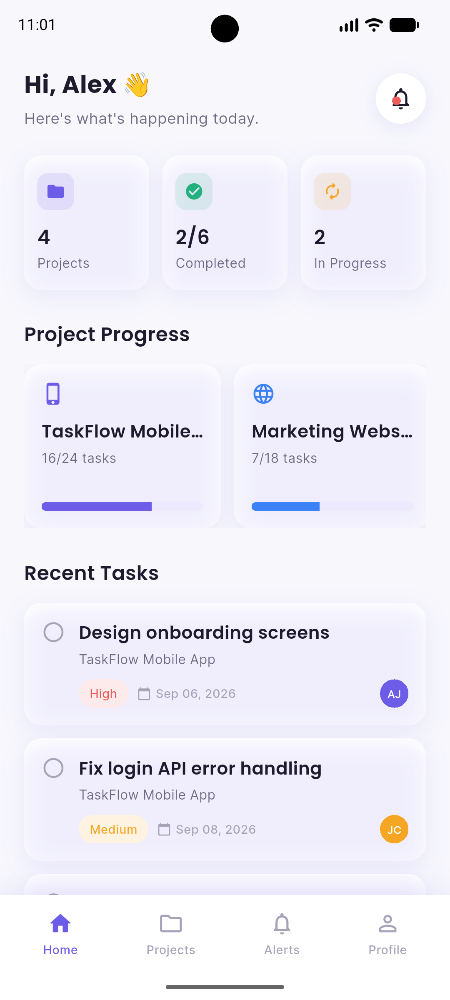
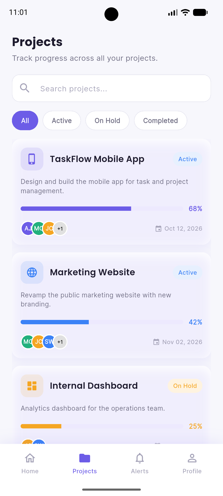
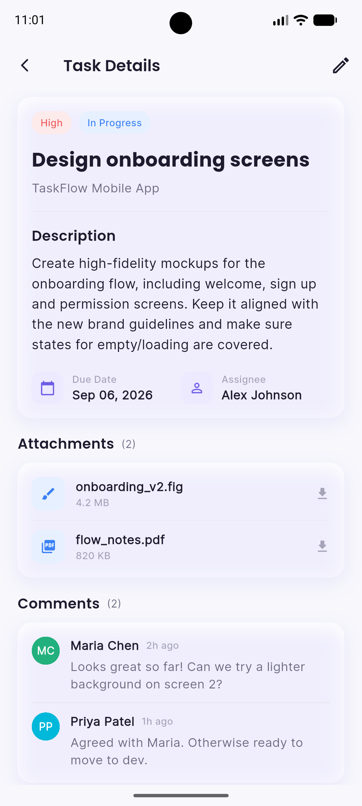
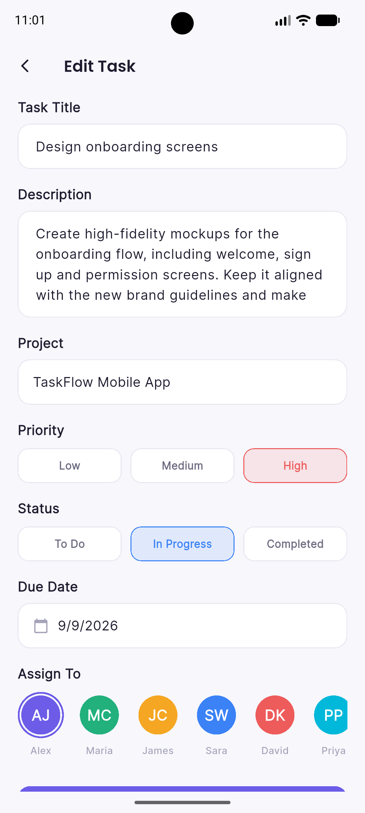
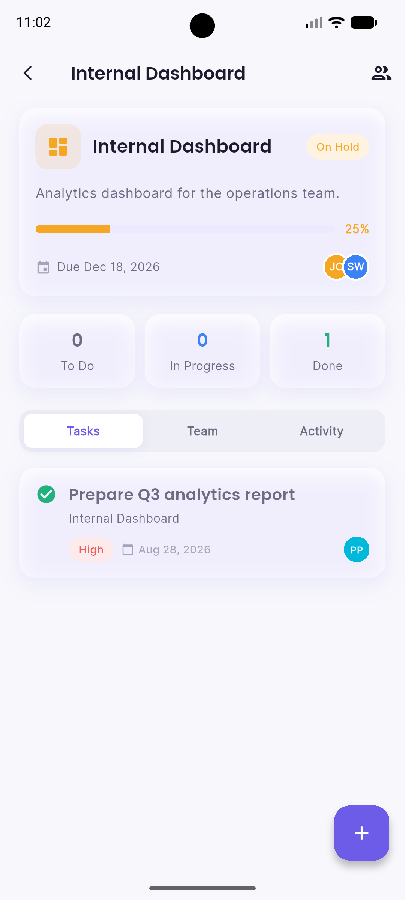
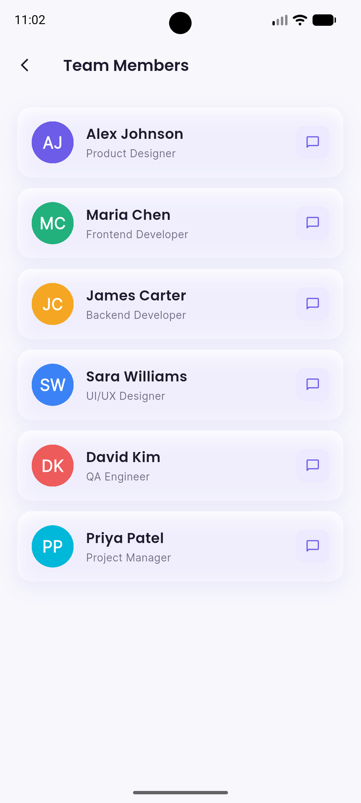
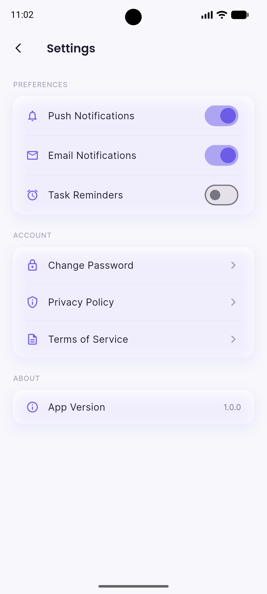

# RimRid Task Flow

A Flutter task and project management app for teams — track projects, manage tasks, and collaborate with your team, backed by Supabase.

## Features

- Dashboard with project stats and recent tasks
- Project tracking with progress and filters (Active / On Hold / Completed)
- Task details with attachments, comments, and editing
- Team member directory
- Notification alerts and app settings

## Screenshots

| Home | Projects | Task Details |
| --- | --- | --- |
|  |  |  |

| Edit Task | Project Detail | Team Members | Settings |
| --- | --- | --- | --- |
|  |  |  |  |

## Getting Started

This project is a starting point for a Flutter application.

A few resources to get you started if this is your first Flutter project:

- [Lab: Write your first Flutter app](https://docs.flutter.dev/get-started/codelab)
- [Cookbook: Useful Flutter samples](https://docs.flutter.dev/cookbook)

For help getting started with Flutter development, view the
[online documentation](https://docs.flutter.dev/), which offers tutorials,
samples, guidance on mobile development, and a full API reference.
